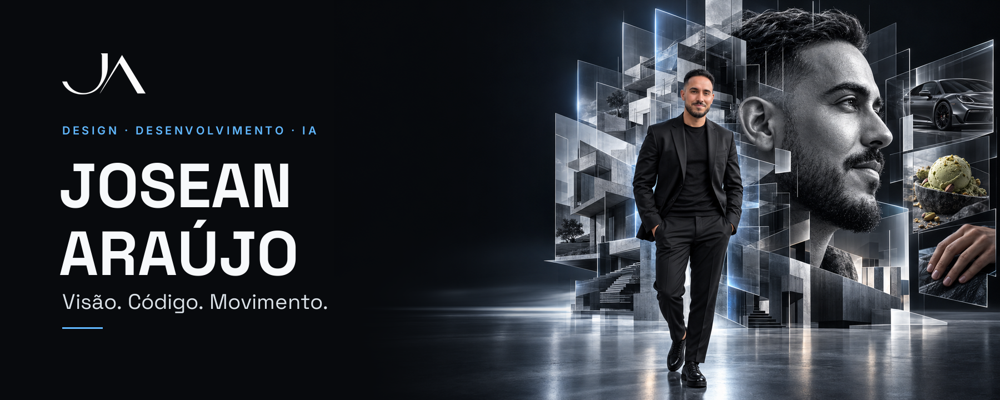
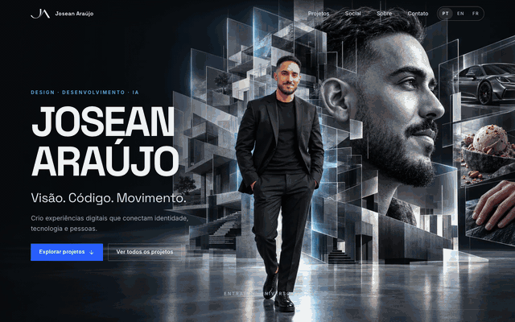
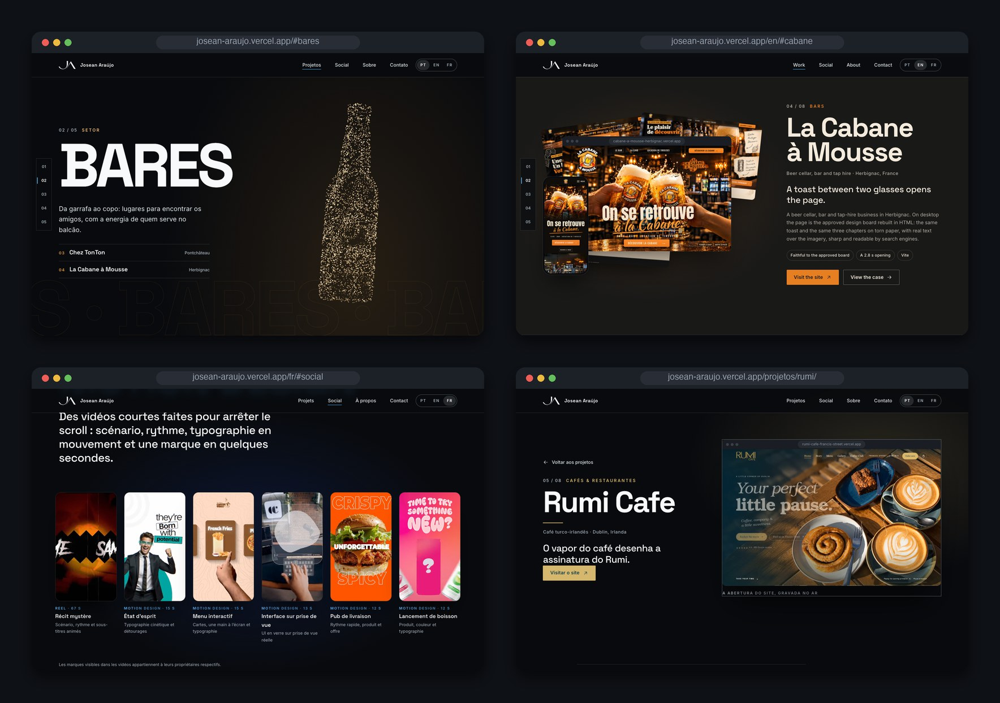
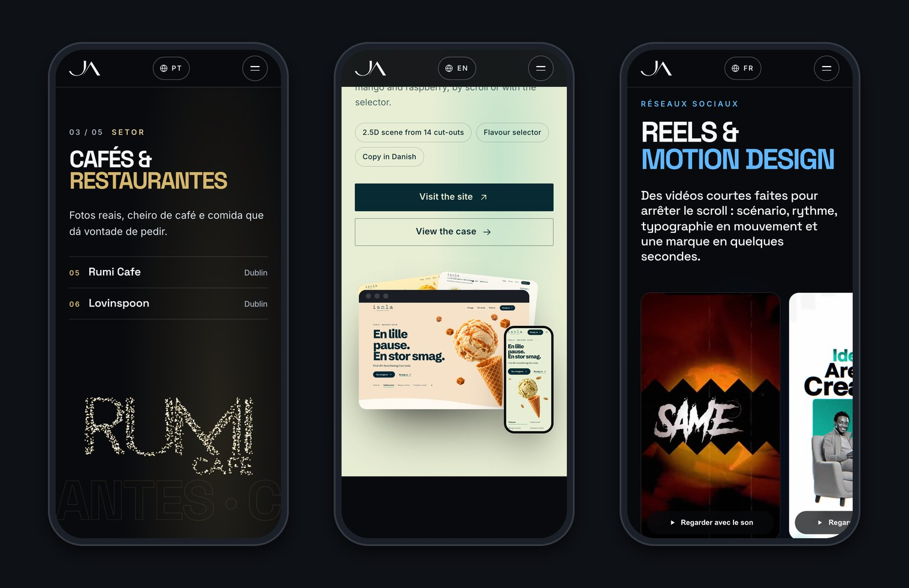

<div align="center">



<h3>A personal portfolio, "Inside the Creative Mind": a monumental portrait opens into planes, the windows of eight real client sites emerge and burst out to the sides, and the work follows, sorted by sector.</h3>

<p>
  <a href="https://josean-araujo.vercel.app"><strong>🌐 Live site</strong></a>
  &nbsp;·&nbsp;
  <a href="#hero-animation"><strong>🎬 How the hero works</strong></a>
  &nbsp;·&nbsp;
  <a href="#the-work"><strong>🗂️ The work</strong></a>
  &nbsp;·&nbsp;
  <a href="#getting-started"><strong>🛠️ Run it locally</strong></a>
</p>

<p>
  <a href="https://josean-araujo.vercel.app"></a>
  
  
  
  
  
</p>

</div>

<br />

## 🚀 Overview

This is the portfolio of **Josean Araújo**: design, development and AI. It follows the *Inside the Creative Mind* direction from the art kit: graphite, silver and a contained blue light; large neo-grotesque type; photography, silence and controlled movement. A **monumental portrait** opens into planes while Josean stays in the foreground, the **windows of eight live sites** emerge from the same architecture, all at the same scale, and **burst out to the sides**; then the work begins with the Automotives STA chapter.

The work is **eight websites Josean designed, built and sold to real businesses**, sorted by sector: cars and motorbikes, bars, cafés and restaurants, an ice cream shop and a barbershop. Every sector opens with its name in giant type and a **cloud of particles that forms a real object from one of its sites** (the Chez TonTon bottle becomes the Cabane glass; the Rumi signature becomes the Lovinspoon sandwich). Every site arrives in its own colours, with **its opening recorded live** playing in a browser, three of its screens fanning out behind it and its phone screen in front. Then come **reels and motion graphics**, the full list, who Josean is (including his years presenting and teaching technology at Microsoft in Dublin and at Hewlett Packard Enterprise in Paris), how he works, and one way to start a conversation. All of it reads in Portuguese, English or French.

- **Cinematic first impression**: a pinned 2.5D scene made of the kit's own layers and the live sites' first screens, with live HTML text over it
- **The real work, shown moving**: every site is captured from production (stills and its opening as a loop), with a link to the live site and a case page of its own
- **A motion language of its own**: giant type revealed line by line, cards that fan open, words that light up, particles that form objects (after HorizonX *MOTIF* and *Sorvine*, written from scratch)
- **Readable without the animation**: the same content in natural order with reduced motion, on short screens and without JavaScript
- **Three languages**: Portuguese at `/`, English at `/en/` and French at `/fr/`, every page translated in full, with a PT · EN · FR switch in the header

<br />

<a name="hero-animation"></a>

## 🎬 The hero animation

<div align="center">
  <a href="https://josean-araujo.vercel.app"></a>
  <sub>Scroll-scrubbed on the live site · captured at 1440 × 900</sub>
</div>

<br />

The stage stays pinned for 320svh on wide screens and plays five acts:

| Scroll    | What happens                                                                                                              |
| :-------- | :------------------------------------------------------------------------------------------------------------------------ |
| 0.00–0.14 | **Presence**: the finished art, the name, *Visão. Código. Movimento.*; a silver light runs along the edge of the portrait |
| 0.14–0.34 | **Unfold**: under one band of light the art hands over to its own layers; the glass planes drift apart, the portrait recedes about 5 %, Josean barely moves |
| 0.34–0.62 | **Reveal**: eight windows, each the live site's first screen, emerge from behind the portrait, three in front and five further back; *Cada ideia abre um novo universo.* with the five sectors |
| 0.62–0.74 | **Hold**: the windows drift a little while the sectors are named                                                          |
| 0.74–1.00 | **Burst**: the windows fly out to the sides, each along its own line from the face, front ones first; the light fades    |
| after     | **Car → scan → engine**: the hero lets go and the work opens with the STA chapter; a blue line scans the body, then the engine takes the scene behind a vertical edge |

**Under the hood**

- 🧩 **One smoothed scroll value drives everything.** The scene is a pure function of the scroll position (`render()` in `src/js/hero.js`), so it runs backwards as cleanly as forwards and rebuilds on resize.
- 📐 **Registered with SIFT.** The finished art paints first, then hands over to the transparent layers. The kit says they are not pixel-registered, so `scripts/register-hero.py` finds Josean and the portrait on the art with SIFT keypoints and a RANSAC similarity and writes the result to `src/data/hero.json`. The swap happens under a band of silver light, as the kit asks.
- 🪟 **Real perspective, no 3D engine.** Every window is a projective transform (`matrix3d`) computed from four corners; the burst pushes each one along the line from the face to its own centre, so the left windows leave left and the right ones leave right.
- 🎯 **One car, once.** Automotives STA appears in the hero as one window among eight; its car, scan and engine play only in its own chapter, right after the hero.
- 🎛️ **Three modes, picked before the first paint.** `hero-scroll` on wide screens, `hero-compact` on phones and tablets (210svh, five windows, the same burst), `hero-static` with reduced motion, on short screens (such as 200 % zoom) and without JavaScript.
- ✍️ **Text stays live.** The name, captions and links are HTML over the scene, they only fade and move at most 40 px, and they stay focusable only while visible.

<br />

<a name="the-work"></a>

## 🖥️ Sections

<div align="center">
  
</div>

<br />

| #   | Section                                   | Anchor        | Role                                                                                              |
| :-- | :---------------------------------------- | :------------ | :------------------------------------------------------------------------------------------------ |
| 01  | **Josean Araújo**                         | `#inicio`     | The scene, **Explorar projetos** and a direct way to the full list                                |
| 02  | **Automotivos** · Automotives STA, GetMOTO | `#automotivos` | Right after the hero: car → scan → engine; then the scooter workshop in Luton                  |
| 03  | **Bares** · Chez TonTon, La Cabane à Mousse | `#bares`    | Giant type and particles: the bottle becomes the glass; then the two bars                        |
| 04  | **Cafés & Restaurantes** · Rumi Cafe, Lovinspoon | `#cafes` | The Rumi signature becomes the Lovinspoon sandwich; then the two Dublin cafés                 |
| 05  | **Sorveteria** · isola                    | `#sorveteria` | A scoop and cone made of particles; then the flavours in orbit                                    |
| 06  | **Barbearia** · Bayro Cut                 | `#barbearia`  | The clipper made of particles; then the barbershop in Greve                                       |
| 07  | **Reels & motion graphics**               | `#social`     | Six vertical pieces: muted previews while on screen, the full piece with sound in a player        |
| —   | **Todos os projetos**                     | `#indice`     | The eight sites by sector, as a plain list: the way in without the animation                     |
| 08  | **Tecnologia começa com pessoas.**        | `#sobre`      | A silver pause: Josean at human scale, his experience at Hewlett Packard Enterprise in Paris and Microsoft in Dublin, base, path, languages, LinkedIn |
| 09  | **Da intenção à experiência.**            | `#processo`   | Entender → Dar forma → Construir e refinar, with a line that runs through the steps as you read   |
| 10  | **Vamos criar o próximo.**                | `#contato`    | The closing portal and one path: **Conversar no LinkedIn**                                         |

The names above are the Portuguese ones; the English and French pages carry the same sections under the same anchors. A fixed index of the five sectors follows the work on wide screens. Every site also has a case page in each language (`/projetos/<slug>/`, `/en/work/<slug>/`, `/fr/projets/<slug>/`): its opening recorded live, the project, the direction with the site's own palette and typefaces, three desktop screens and two phone screens of the live site, the movement, what Josean did, and the next case. The earlier concept-study URLs (`/estudos/…`, `/en/studies/…`, `/fr/etudes/…`) redirect to the new pages or to the list.

<br />

## 📱 Mobile first, motion optional

<div align="center">
  
</div>

<br />

- On phones the vertical art keeps Josean whole: the name sits above him, the sentence and the buttons on the floor below him
- A short pinned scene (210svh) brings five windows up and bursts them out, then the sectors follow in a natural vertical flow; the particles stand under the text and the reels become a row you swipe
- With `prefers-reduced-motion`, on short screens and without JavaScript there is no pinned section: a still hero, still particle objects, every site in order and no video playing on its own
- Below 900 px the four sections live in a full-screen menu, and the PT · EN · FR switch folds into a globe button; the header fits from 320 px in all three languages
- No video loads before it is needed: the home page opens with about 1.3 MB on a phone and none of the 8 loops or 6 reels
- Every touch target is at least 44 px, no horizontal scroll at 375 px, and the layout holds at 200 % zoom

<br />

## ✨ Highlights

- **🎞️ One timeline, five acts**: presence, unfold, reveal, hold and burst, scrubbed with long, soft deceleration and fully reversible
- **✨ Particles that form real objects**: `scripts/emblems.py` samples 4,200 points from a cut-out of each site (density follows light, edges and local detail); `src/js/openers.js` draws them on a canvas, morphs them from one object to the next with the scroll and pushes them away from the pointer. It only runs while its sector is on screen
- **🃏 Cards that fan open, type that assembles**: three real screens of each site open around its browser as the block comes in; sector names rise line by line in a mask; the manifesto lights up word by word (`src/js/kinetic.js`)
- **🎥 The sites' own motion, recorded**: `scripts/capture/` scrubs each scroll-driven hero frame by frame and records the timed openings live, then builds seamless loops (forward and back, or a soft dissolve); they play only on screen
- **🌐 Each site in its own colours**: every block takes the site's ground, ink and accent from its README, with deeper label and button colours wherever the accent would fall under 4.5:1
- **🗣️ Three languages, real pages**: each language has its own URLs, `lang`, title, description and social preview, linked by `hreflang`; on a first visit the root follows the browser's language (any language other than Portuguese or French gets English), and a choice made in the switch is remembered and keeps the section you were reading
- **🗂️ One source for 27 pages**: `npm run pages` writes the three home pages and the 24 case pages from two templates (`scripts/pages/`), the dictionaries in `src/i18n/` and `src/data/projects.js`
- **♿ Accessible by construction**: skip link, real headings, labelled navigation, a menu that holds focus and closes with Escape, a native `<dialog>` for the player, visible focus, hidden-until-animated states that only apply once the code that reveals them runs

<br />

## 💻 Tech stack

| <br />Vite 6 | <br />JavaScript | <br />HTML5 | <br />CSS3 | <br />OpenCV | <br />Python |
| :---: | :---: | :---: | :---: | :---: | :---: |

### Why this stack?

- **Vite + plain JavaScript**: a portfolio doesn't need a framework runtime; the pages are static HTML with small, focused modules (about 15 KB of JavaScript, gzipped; each sector's particle points load on their own, about 21 KB)
- **No animation library**: the hero is a pure function of one scroll value, the particles are a hand-written canvas engine, and the rest is CSS driven by a few custom properties (`--p`, `--o`, `--wp`)
- **sharp + OpenCV for the assets**: cutting, registering and tracing the kit's images happens once, at build time, not in the browser
- **Self-hosted Space Grotesk and Inter**: the type the brief suggests, with no third-party font requests

<br />

## 🎨 Design system

| Token      | Value                                                                        | Use                                              |
| :--------- | :--------------------------------------------------------------------------- | :----------------------------------------------- |
| Graphite   |  | Page background                                  |
| Surface    |  | Raised panels, the study pages' footer band      |
| Silver     |  | Secondary text, the About pause (14.9:1 on graphite) |
| White      |  | Titles and body (19.3:1 on graphite)             |
| Blue light |  | The narrative light, labels, focus (9.2:1)       |
| UI blue    |  | Primary buttons (white text 5.0:1)               |

- **Type**: Space Grotesk for display, 72–140 px titles on desktop and 40–64 px on mobile; Inter for text, 16–18 px body, labels from 12 px, controls from 14 px
- **Grid**: 12 columns on desktop, 4 on mobile, 6 % margins, 1,440 px content width
- **Rhythm**: 64–160 px between sections
- **Motion**: editorial entrances of 22 px over 700 ms; hover 220 ms with at most 2 % of scale; everything respects `prefers-reduced-motion`

<br />

<a name="getting-started"></a>

## 🛠️ Getting started

```bash
# Clone the repository
git clone https://github.com/Jeanfr1/Myportfolio.git
cd Myportfolio

# Install dependencies (Node 20.9+)
npm install

# Start the dev server  →  http://localhost:5173
npm run dev

# Production build  →  dist/
npm run build

# Preview the production build
npm run preview

# Regenerate the WebP images, favicon and social image from the kit
npm run images

# Rewrite every page in PT, EN and FR from the templates and dictionaries (dev and build run it first)
npm run pages

# Re-sample the particle emblems from the cut-outs in design/emblems/ (Python 3, numpy, Pillow)
python3 scripts/emblems.py

# Re-capture the eight live sites and the social videos (Playwright with Chrome, ffmpeg), then write the web assets
node scripts/capture/stills.mjs <caps>
node scripts/capture/loops.mjs <frames> scrub && node scripts/capture/loops.mjs <frames> live
python3 scripts/capture/build-loops.py <frames> <loops>
bash scripts/capture/social.sh <exports> <social>
node scripts/site-assets.mjs <caps> <loops> <social>

# Optional, Python 3 (opencv-python, numpy, Pillow): re-register the hero layers, re-trace the monogram
python3 scripts/register-hero.py
python3 scripts/trace-logo.py
```

<br />

## 📁 Project structure

```
Myportfolio/
├── index.html                    # PT: hero → work by sector → social → all projects → about → process → contact
├── en/index.html · fr/index.html # The same page in English and French
├── projetos/<slug>/              # The eight case pages in Portuguese
├── en/work/<slug>/ · fr/projets/<slug>/  # …in English and French (all 27 pages written by npm run pages)
├── src/
│   ├── main.js · case.js         # Entries: fonts, styles, module init
│   ├── styles/                   # main.css (tokens, hero, STA, about…) · work.css (sectors, sites, social, menu) · case.css
│   ├── i18n/
│   │   ├── locales.js            # The three languages, their URLs and the site address
│   │   └── pt.js · en.js · fr.js # Every text: sectors, the eight cases, the reels, the About experience
│   ├── data/
│   │   ├── projects.js           # The eight sites (live URL, colours, type, palette), the five sectors, the six reels
│   │   ├── emblems/*.json        # Particle points of each emblem (written by scripts/emblems.py)
│   │   └── hero.json             # Layer registration on the hero art (generated by register-hero.py)
│   ├── assets/img · assets/video # WebP stills and posters of the live sites; their loops and the reels (H.264)
│   └── js/
│       ├── hero.js               # The five acts: art → layers, planes, eight windows, hold, burst
│       ├── sta.js                # Car → scan → engine
│       ├── openers.js            # Sector openers: pin progress and the particle canvas
│       ├── kinetic.js · scenes.js # Words that light up · scroll progress for the fans and titles
│       ├── loops.js · social.js  # Site loops on screen · the reels wall and its player
│       ├── menu.js · lang.js     # The phone menu · the PT · EN · FR switch
│       └── rail.js · header.js · anchors.js · reveal.js · motion.js
├── design/emblems/               # The cut-outs the particles are made of, one per site
├── josean-portfolio-ultrapremium/ # The art kit: references, concepts, hero, layers, roteiros, tokens
├── scripts/
│   ├── build-pages.mjs · pages/  # The page builder and its templates (home.mjs, case.mjs, shared.mjs)
│   ├── capture/                  # Stills, loops and reels from the live sites and the exports
│   ├── site-assets.mjs           # Captures → WebP sizes, posters, loops and reels in src/assets
│   ├── emblems.py                # Cut-outs → particle points
│   ├── optimize-images.mjs       # Kit PNG → WebP for the hero, STA and closing; favicon, OG image
│   ├── register-hero.py          # SIFT registration of the hero layers
│   └── trace-logo.py             # JA monogram → SVG
├── public/                       # Favicon, touch icon, Open Graph image
└── vercel.json                   # Vite build, redirects from the old study URLs, one-year cache for hashed assets
```

<br />

## 🚀 Deployment

Hosted on **Vercel** and connected to this repository: every push to `main` ships to production.

**Live site:** [josean-araujo.vercel.app](https://josean-araujo.vercel.app)

`vercel.json` pins the Vite build, redirects the earlier `/estudos/…` URLs and caches hashed assets (images, loops, reels) for a year; `.vercelignore` keeps the art kit out of the upload.

| Setting          | Value           |
| :--------------- | :-------------- |
| Framework        | Vite            |
| Build command    | `npm run build` |
| Output directory | `dist`          |

<br />

## 📌 Content checklist

Each open item is marked `TODO(portfolio)` in the code.

- [ ] Approve the hero sentence (from the roteiro) and review the English and French copy (`src/i18n/en.js`, `src/i18n/fr.js`), including the eight cases
- [x] The work: eight sites sold to real businesses (Josean's list), by sector; *Cafés & Restaurantes* as one sector, as he chose; isola added as the only ice cream shop
- [x] Social media: six reels and motion graphics from Josean's exports (the Wins piece left out, as he asked); brands shown belong to their owners, as the page says
- [x] About: the Hewlett Packard Enterprise and Microsoft experience, as written in Josean's Technical Trainer CV (13/07/2026), his choice
- [ ] Email, GitHub and WhatsApp: add them only once the real addresses are confirmed; LinkedIn stays the main path
- [ ] Custom domain: change `SITE` in `src/i18n/locales.js` and run `npm run pages` (canonical, `og:url`, `hreflang` and `og:image` follow)
- [ ] When a live site changes or moves, check its URL on Vercel, update `url` in `src/data/projects.js` and re-run the captures

<br />

## 🙏 Acknowledgments

- The *Inside the Creative Mind* art kit: direction, concepts, layers and roteiros
- **[Space Grotesk](https://fonts.google.com/specimen/Space+Grotesk)** by Florian Karsten and **[Inter](https://rsms.me/inter/)** by Rasmus Andersson (both OFL)
- **[sharp](https://sharp.pixelplumbing.com)** and **[OpenCV](https://opencv.org)** for the asset pipeline
- **[Playwright](https://playwright.dev)** and **[FFmpeg](https://ffmpeg.org)** for the captures of the live sites and the loops
- The motion language of the work and the social wall takes its cue from HorizonX's *[MOTIF](https://horizonx.so/explore/motif)* and *[Sorvine](https://horizonx.so/explore/sorvine)*; the code here is written from scratch
- **[Vite](https://vite.dev)** and **[Vercel](https://vercel.com)**

<br />

---

<div align="center">
  
  <p><strong>Visão. Código. Movimento.</strong></p>
  <p>Built with ❤️ by <a href="https://github.com/Jeanfr1">Jean</a></p>
  <sub>© 2026 Josean Araújo. Websites created for real businesses.</sub>
</div>
